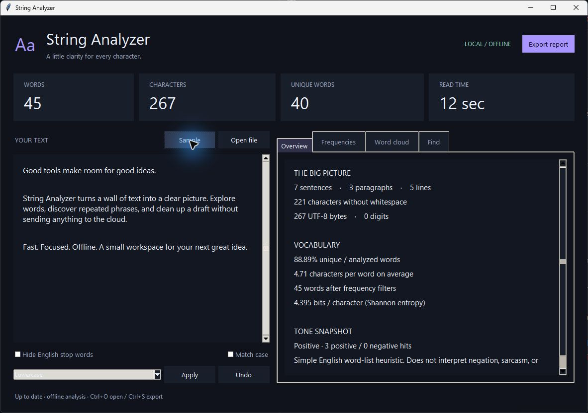
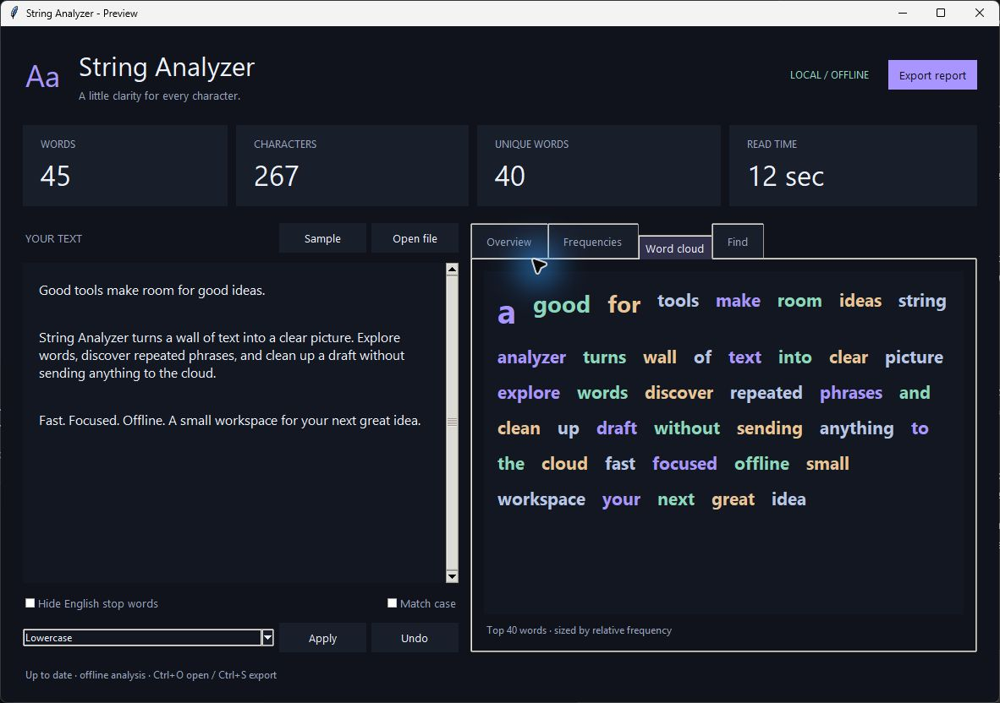

# String Analyzer

A lightweight, offline text workbench with live statistics, phrase analysis, text cleanup, and a dark desktop UI. No account. No model downloads.

Open **StringAnalyzer.exe**, paste your text, and explore. For a Windows build, open a successful workflow run and download **StringAnalyzer-Windows** under Artifacts (GitHub sign-in required). Extract the ZIP and run the EXE; no installer or Python needed.

- See word, character, sentence, paragraph, vocabulary, and reading-time statistics update as you type.
- Explore words, letters, punctuation, repeated two- and three-word phrases, and a word cloud.
- Filter common English words, preserve case, and highlight text matches.
- Clean up whitespace, change case, normalize Unicode, sort or deduplicate lines. Undo edits.
- Open UTF-8 files and export complete JSON, CSV, or text reports. Use the same engine from the command line.
- Optional MySQL and Kafka adapters stream reports without adding dependencies to the desktop app.

App preview

**Run from source:** Python 3.10+ with Tk installed, then `python stringanalyzer.py`. No pip install required. Windows 10/11 is the portable build target; source also runs on macOS and Linux with Tk.

Analysis is local and accepts up to 2,000,000 characters. Tone is a small English word-list heuristic; sentence splitting and reading time are estimates. No text or settings are saved automatically.

[Usage](docs/USAGE.md) | [Development & builds](docs/DEVELOPMENT.md) | [What changed in v2](docs/CHANGELOG.md)
